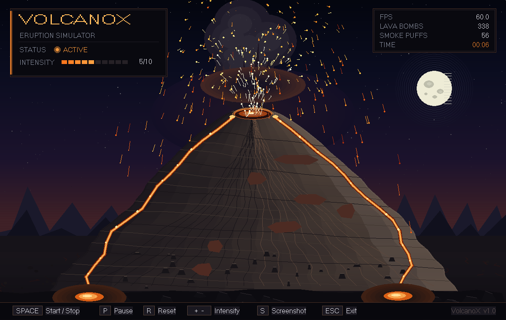
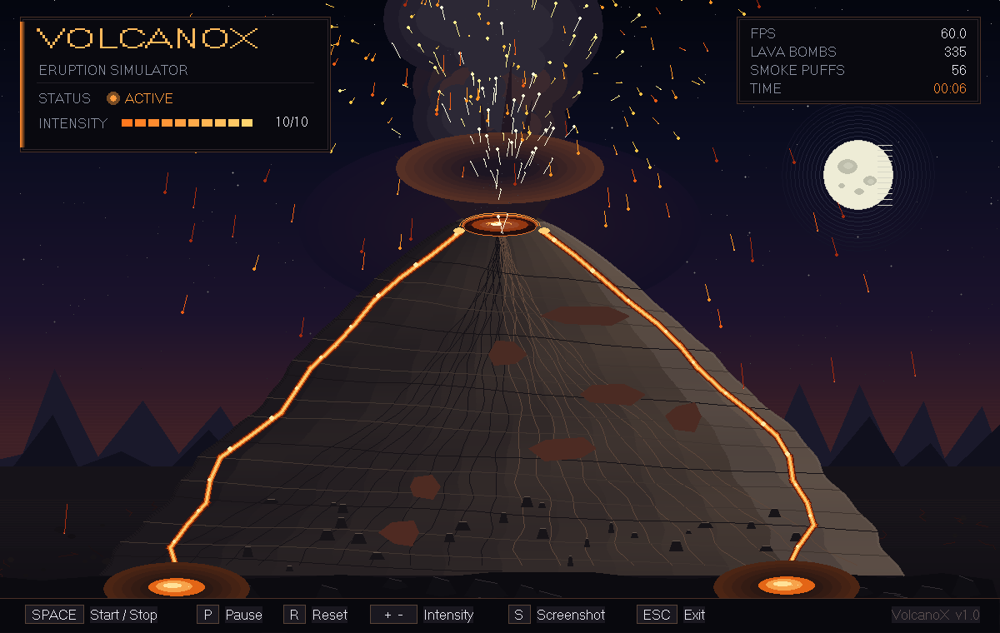
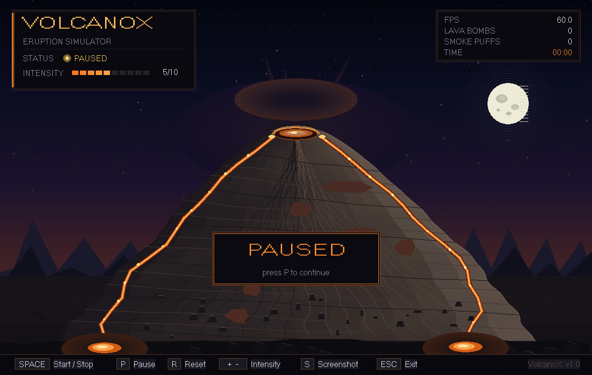
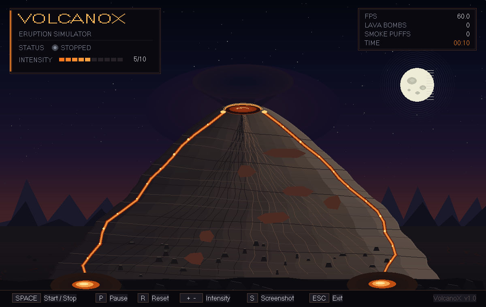

# VolcanoX — Interactive 2D Volcano Eruption Simulator

A complete Computer Graphics lab project in **C++** using **Graphics.h (WinBGIm)**
on Windows. The program draws a moonlit stratovolcano, animates glowing lava
rivers and flying lava bombs, simulates smoke / ash / embers / meteors, and
responds to live keyboard controls.



## Features

| Scene | Animation | Interaction |
|---|---|---|
| Night sky gradient with 250 stars | Pulsing crater glow, light rays and heat dome | `SPACE` start / stop the eruption |
| Shaded moon with craters and halo | Two lava rivers with sliding hot blobs | `P` pause / resume |
| Three layers of distant mountains | Lava bombs with gravity, drag and cooling | `R` reset simulation |
| 14-band shaded volcano cone | Three-layer smoke puffs with wind | `+` / `-` intensity 1–10 |
| Erosion gullies and boulders | Ash flakes, flickering embers | `S` save BMP screenshot |
| Molten pools on the plain | Rare meteor streak | `ESC` exit |
| Frame-rate independent simulation | Live FPS / particle / time HUD | Pause banner and status light |

Everything is drawn with standard **WinBGIm / BGI** functions: `line`, `bar`,
`rectangle`, `circle`, `ellipse`, `fillellipse`, `fillpoly`, `sector`, `putpixel`,
`outtextxy`, `imagesize`, `getimage`, `putimage`, `swapbuffers`, and so on.
No OpenGL, DirectX, or third-party graphics library is used.

## Quick start

The compiled program **`volcanox.exe`** is already included in this folder.
Double-click it, or run:

```powershell
.\volcanox.exe
```

To rebuild from source (the script finds MinGW automatically):

```powershell
.\build.bat
```

or:

```powershell
powershell -ExecutionPolicy Bypass -File build.ps1 -Target final
```

Build the final program plus all five tutorial stages:

```powershell
powershell -ExecutionPolicy Bypass -File build.ps1 -Target all
```

Manual command (if `g++` is on `PATH`):

```powershell
g++ -O2 -std=c++17 src\volcano.cpp -o volcanox.exe -I include -L lib `
    -lbgi -lgdiplus -lcomdlg32 -lgdi32 -luuid -loleaut32 -lole32 -lwinmm `
    -static -mwindows
```

> The project is self-contained: WinBGIm headers are in `include/` and the
> 64-bit static library is `lib/libbgi.a`. See **[docs/SETUP.md](docs/SETUP.md)**
> if you need to install the compiler or rebuild `libbgi.a` from source.

## Controls

| Key | Action |
|---|---|
| `SPACE` | Toggle eruption on / off. Existing particles finish their lives. |
| `P` | Pause / resume simulation. Rendering continues, so the paused scene is visible. |
| `R` | Reset particles, time, wind, glow and intensity. |
| `+` or `=` | Increase intensity (maximum 10). |
| `-` or `_` | Decrease intensity (minimum 1). |
| `S` | Save the current frame as `volcanox_shot.bmp` (WinBGIm writes BMP). |
| `ESC` | Exit. |

Higher intensity increases bomb count, burst size, smoke rate and glow.
Developer flags used for automated screenshots:

```text
volcanox.exe --bench 300
volcanox.exe --bench 300 --shot frame.bmp
volcanox.exe --bench 300 --intensity 10 --shot frame.bmp
volcanox.exe --bench 30 --paused --shot paused.bmp
volcanox.exe --bench 600 --stopped --shot stopped.bmp
```

## Project structure

```text
volcano/
├─ src/
│  └─ volcano.cpp              complete final program (~1,500 lines)
├─ stages/
│  ├─ stage1_window.cpp        graphics test + first window
│  ├─ stage2_volcano.cpp       static shaded scene
│  ├─ stage3_lava.cpp          animated crater, rivers, bombs, pools
│  ├─ stage4_particles.cpp     smoke, ash, embers, meteor, statistics
│  ├─ stage5_controls.cpp      complete program (mirror of src/volcano.cpp)
│  └─ build/                   stage executables (created by the build script)
├─ include/                    graphics.h, winbgim.h, winbgitypes.h
├─ lib/libbgi.a                locally built 64-bit WinBGIm static library
├─ screenshots/                PNG previews used by the docs
├─ tools/
│  ├─ inspect.ps1              text-mode screenshot inspector (ASCII + stats)
│  ├─ probe.ps1                classified colour map / pixel probes
│  ├─ capture.ps1              window capture helper (fallback)
│  └─ filltest.cpp             proof that filled shapes use the draw colour
├─ docs/
│  ├─ SETUP.md                 install MinGW + rebuild WinBGIm + VS Code
│  ├─ TUTORIAL.md              stage-by-stage build guide
│  ├─ ALGORITHM.md             algorithms, pseudocode and flowcharts
│  ├─ REPORT.md                university-style project report
│  └─ VIVA.md                  viva / oral-exam questions and answers
├─ .vscode/                    tasks, launch, IntelliSense, settings
├─ build.ps1 / build.bat       build final program or any stage
├─ volcanox.exe                ready-to-run build
└─ README.md
```

## The five stages

| Stage | File | What it adds | Preview |
|---|---|---|---|
| 1 | `stages/stage1_window.cpp` | Window, colours, double buffering, stars, moon, FPS, ESC | `screenshots/stage1.png` |
| 2 | `stages/stage2_volcano.cpp` | Static shaded volcano, crater lake, mountains, background cache | `screenshots/stage2_scene.png` |
| 3 | `stages/stage3_lava.cpp` | Simulation clock, pulsing crater, rivers, lava bombs, ground pools | `screenshots/stage3_lava.png` |
| 4 | `stages/stage4_particles.cpp` | Smoke, ash, embers, meteor, live statistics | `screenshots/stage4_particles.png` |
| 5 | `stages/stage5_controls.cpp` | Full controls, HUD, pause, reset, intensity, screenshot | `screenshots/stage5_controls.png` |

Each stage is a **standalone, compilable program**. Build one with:

```powershell
powershell -ExecutionPolicy Bypass -File build.ps1 -Target stage3
```

Read **[docs/TUTORIAL.md](docs/TUTORIAL.md)** for the explanation of every step.

## Screenshots

| Active | Maximum intensity |
|---|---|
|  |  |

| Paused | Stopped (cooling crater) |
|---|---|
|  |  |

## How it works (short version)

1. **Static scenery is drawn once.** Sky, stars, moon, mountains, ground and the
   volcano are rendered into an off-screen bitmap with `imagesize` + `getimage`.
2. **Every frame starts with `putimage`.** The cached scene is blitted back, so
   the previous frame's particles disappear instantly.
3. **Only dynamic objects are redrawn.** Smoke, crater glow, lava rivers, bombs,
   ash, embers and the meteor are drawn in a fixed order.
4. **Double buffering** (`initwindow(..., dbflag=true)` +
   `setrefreshingbgi(false)` + `swapbuffers()`) removes flicker.
5. **A delta-time clock** keeps particle speed independent of frame rate.
6. **State-cached colour functions** avoid thousands of redundant GDI object
   creations per second.

Measured on the development laptop at 1200×760: about **12.2 ms/frame** in
active eruption and **5.9 ms/frame** when stopped (bench mode, 60 Hz update).
The interactive loop targets 60 FPS with a 16 ms frame budget.

## Requirements

- Windows 10 / 11 (64-bit)
- MinGW-w64 64-bit with g++ (tested with GCC 16.2.0 from WinLibs)
- WinBGIm 64-bit `libbgi.a` (included) and its three headers (included)
- VS Code with the Microsoft C/C++ extension (recommended), or any editor

No external runtime DLLs are needed because the program is linked statically
(`-static`).

## Documentation

- **[docs/SETUP.md](docs/SETUP.md)** — install everything from zero, build
  `libbgi.a`, configure VS Code, troubleshooting.
- **[docs/TUTORIAL.md](docs/TUTORIAL.md)** — five-stage build-up with key code.
- **[docs/ALGORITHM.md](docs/ALGORITHM.md)** — formulas, pseudocode, flowcharts,
  complexity and performance.
- **[docs/REPORT.md](docs/REPORT.md)** — complete university-style report.
- **[docs/VIVA.md](docs/VIVA.md)** — 45 viva questions with answers.

## Notes and limitations

- WinBGIm's screenshot function always writes a **BMP**, regardless of the file
  extension. Use the included `tools/inspect.ps1` to analyse a shot as text.
- The program is CPU-rendered by design (BGI). It is intended for a lab project,
  not for 3D or GPU workloads.
- `COLOR(r,g,b)` in WinBGIm packs bytes as `0x03BBGGRR`; the helper functions
  `redOf`, `greenOf`, `blueOf` and `mixColor` hide that detail.
- If Windows display scaling is above 100%, run the exe directly or set the
  compatibility flag "Override high DPI scaling behaviour → Application".

## Credits

- WinBGIm / BGI compatibility layer: original WinBGIm by Konstantin Knizhnik et
  al., 64-bit port by the WinBGIm-64 project.
- All scene artwork, particle logic, HUD and documentation in this repository
  were written for this project.

Educational use is permitted. Have fun making the volcano angrier.
