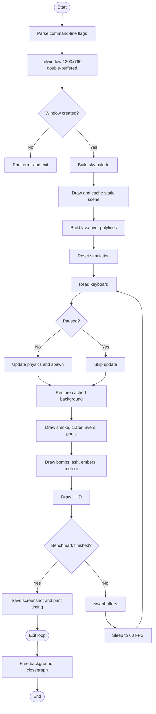
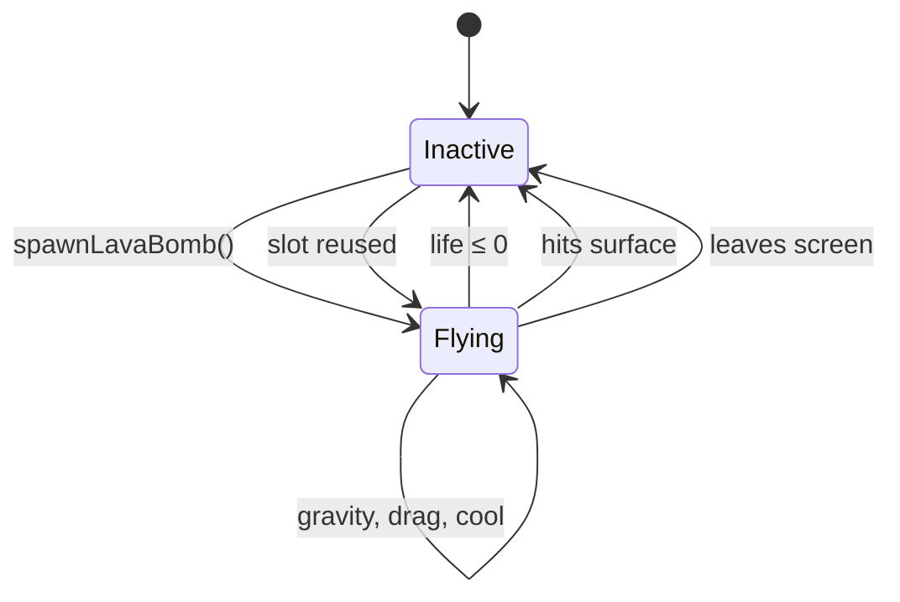
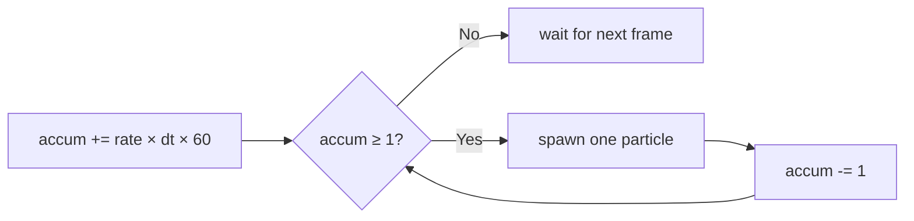

# Algorithms and Design — VolcanoX

This document explains **how** the simulator works: the coordinate system, the
data structures, every important formula, the update rules, the rendering
pipeline, pseudocode and flowcharts, and the performance analysis.

---

## 1. Coordinate system and screen layout

WinBGIm uses a **top-left origin**: `x` grows to the right, `y` grows
**downwards**. The window is 1200 × 760.

```text
(0,0) ─────────────────────────────────────────────► x
  │   sky gradient                          moon ●
  │
  │            ╱▔▔▔╲  crater (600, 271)
  │           ╱     ╲
  │          ╱       ╲        mountain ranges
  │         ╱         ╲
  │        ╱           ╲
  │  ─────╱─────────────╲──────  HORIZON_Y = 560
  │       ground / plain
  │  ───────────────────────────  GROUND_Y = 690
  │       foreground strip
  ▼
  y                          control bar at y = 718
```

| Constant | Value | Meaning |
|---|---:|---|
| `SCREEN_W` | 1200 | window width |
| `SCREEN_H` | 760 | window height |
| `CRATER_X` | 600 | crater centre x |
| `CRATER_Y` | 271 | crater rim y |
| `CRATER_RX` | 44 | crater radius x |
| `CRATER_RY` | 12 | crater radius y |
| `SUMMIT_Y` | 250 | top of the cone |
| `HORIZON_Y` | 560 | where distant mountains stand |
| `GROUND_Y` | 690 | top of the foreground |

The layout is **hard-coded to one resolution** on purpose: every formula,
polygon and HUD panel is tuned for 1200 × 760. Keeping it fixed makes the code
simple and predictable for a lab project.

---

## 2. Program architecture

```text
                    ┌──────────────────────┐
                    │        main()        │
                    │  parse flags         │
                    │  initwindow()        │
                    └──────────┬───────────┘
                               │
          ┌────────────────────┼────────────────────┐
          ▼                    ▼                    ▼
   buildSkyPalette()    buildBackground()      buildFlows()
   (colour table)       (static scene cache)   (river polylines)
                               │
                               ▼
                    ┌──────────────────────┐
                    │     frame loop       │
                    └──────────┬───────────┘
             ┌─────────────────┼──────────────────┐
             ▼                 ▼                  ▼
       handleInput()    updateSimulation(dt)   renderFrame()
       (keyboard)       (physics + spawning)   (background + FX + HUD)
                                                   │
                                                   ▼
                                             swapbuffers()
```

### Module map (source sections)

| Section | Functions | Responsibility |
|---|---|---|
| 1–4 | constants, palette, `struct`s, globals | configuration and state |
| 5 | `makeColor`, `mixColor`, `clampFloat`, `randomFloat`, `randomInt`, `use*` | maths and cached GDI wrappers |
| 6 | `buildSkyPalette`, `skyColorAt`, `backgroundColorAt` | sky colour lookup |
| 7 | `leftEdge`, `rightEdge`, `surfaceYAt` | volcano geometry and collision |
| 8 | `drawSky` … `drawForeground` | static scene painting |
| 9 | `buildBackground`, `restoreBackground` | background cache |
| 10 | `buildFlows`, `drawLavaFlows` | lava rivers |
| 11 | `drawCrater` | crater, lake, glow, rays |
| 12 | `spawnLavaBomb`, `updateLavaBombs`, `drawLavaBombs` | lava bombs |
| 13 | smoke / ash / embers | plume particles |
| 14 | `updateMeteor`, `drawMeteor` | shooting star |
| 15 | `drawGroundPools` | molten pools |
| 16 | `drawBadge`, `drawHud` | interface |
| 17 | `clearParticles`, `resetSimulation`, `updateSimulation`, `handleInput` | control |
| 18 | `main` | startup, loop, shutdown |

---

## 3. Data structures

All particles live in **fixed-size global arrays**. No `new`/`delete` inside the
loop, no fragmentation, and the maximum memory use is known at compile time.

| Structure | Array size | Purpose |
|---|---:|---|
| `LavaBomb bombs[MAX_LAVA]` | 340 | flying lava bombs |
| `SmokePuff smoke[MAX_SMOKE]` | 56 | smoke puffs |
| `AshFlake ash[MAX_ASH]` | 80 | ash flakes |
| `Ember embers[MAX_EMBERS]` | 18 | glowing sparks |
| `Meteor meteor` | 1 | shooting star |
| `LavaFlow flows[NUM_FLOWS]` | 2 × 16 points | lava rivers |
| `Star stars[MAX_STARS]` | 250 | background stars |

### 3.1 `LavaBomb`

```cpp
struct LavaBomb {
    float x, y;             // position in pixels
    float vx, vy;           // velocity in pixels per frame
    float life;             // seconds remaining
    float maxLife;          // initial life (for normalised age)
    float heat;             // 0 = cold, 1 = white hot
    int   size;             // core radius in pixels
    bool  active;           // slot in use?
};
```

### 3.2 `SmokePuff`

```cpp
struct SmokePuff {
    float x, y;
    float vx, vy;
    float radius;           // current radius
    float grow;             // radius growth per frame
    float life, maxLife;
    float wobble;           // 0..1 random lumpiness
    bool  active;
};
```

### 3.3 `AshFlake` and `Ember`

```cpp
struct AshFlake { float x, y, vx, vy, life, maxLife, size; bool active; };
struct Ember    { float x, y, vx, vy, life, maxLife, phase; bool active; };
```

### 3.4 `LavaFlow`

```cpp
struct LavaFlow {
    int   n;                    // number of points (16)
    int   x[FLOW_POINTS];       // polyline x
    int   y[FLOW_POINTS];       // polyline y
    float phase;                // offset for the sliding blobs
};
```

### 3.5 `Star`

```cpp
struct Star { int x, y, brightness; };
```

Only used while building the static background; stars never move.

### 3.6 `active` as a free-list

There is no explicit free list. A spawn scans from index 0 for
`active == false`:

```text
spawn(request):
    for i = 0 .. MAX-1:
        if not array[i].active:
            initialise array[i]
            array[i].active = true
            return
    # all slots busy: the request is dropped
```

This is O(MAX) per spawn but MAX is small (≤ 340) and spawns happen only a few
times per frame. The **oldest slots are not preferentially reused**, which is
fine because particles have similar lifetimes.

---

## 4. Colour model

WinBGIm's `COLOR(r, g, b)` returns a 32-bit integer with the layout
`0x03BBGGRR` (Windows `COLORREF`):

```text
bit 31..24   03        (reserved / flags)
bit 23..16   BB       blue
bit 15..8    GG       green
bit 7..0     RR       red
```

Extraction:

```cpp
int redOf  (int c) { return  c        & 0xFF; }
int greenOf(int c) { return (c >> 8)  & 0xFF; }
int blueOf (int c) { return (c >> 16) & 0xFF; }
```

### 4.1 Linear colour blending

```text
mix(c1, c2, t) = c1 + (c2 - c1) · t,     0 ≤ t ≤ 1
```

Applied per channel:

```text
r = r1 + (r2 - r1) · t
g = g1 + (g2 - g1) · t
b = b1 + (b2 - b1) · t
```

```cpp
int mixColor(int c1, int c2, float t)
{
    if (t < 0.0f) t = 0.0f;
    if (t > 1.0f) t = 1.0f;
    int r = (int)(redOf(c1)   + (redOf(c2)   - redOf(c1))   * t);
    int g = (int)(greenOf(c1) + (greenOf(c2) - greenOf(c1)) * t);
    int b = (int)(blueOf(c1)  + (blueOf(c2)  - blueOf(c1))  * t);
    return makeColor(r, g, b);
}
```

Every gradient, every shaded band, every smoke layer and every cooling lava
colour is a call to this function. It is the single most important helper in
the program.

### 4.2 Fake alpha

WinBGIm has no per-pixel alpha. "Transparent" effects are produced by blending
the object colour with the known background colour **before** drawing it
opaquely:

```text
visible = object · α + background · (1 - α)
```

This works because the background behind the smoke is the sky, whose colour is
known from `skyColorAt(y)`. It would not work over arbitrary scenery, which is
why smoke is drawn near the summit where the background is predictable.

---

## 5. Static scene generation

The static scene is drawn **once**, then cached.

### 5.1 Sky gradient

Four colour stops at fixed heights, linearly interpolated:

```text
y ∈ [0, 170)      SKY_TOP      → SKY_MID
y ∈ [170, 380)    SKY_MID      → SKY_LOW
y ∈ [380, 520)    SKY_LOW      → SKY_HORIZON
y ∈ [520, 760)    SKY_HORIZON  (constant)
```

The result is stored in `skyPalette[760]`, so `skyColorAt(y)` is O(1) with no
arithmetic after startup.

### 5.2 Stars

For each of 250 stars:

```text
x ← rand[0, 1199]
y ← rand[0, 469]
b ← rand[70, 255]
haze ← max(0.35, 1 - y / 620)
colour ← (b·haze, b·haze, (0.9b + 25)·haze)
putpixel(x, y, colour)
if b > 225: draw four dim neighbour pixels (a cross)
```

The `haze` factor dims stars near the horizon, imitating atmospheric
extinction. The cross makes the brightest stars look like points of light
rather than single pixels.

### 5.3 Moon

Ten halo rings from wide/faint to narrow/brighter, then:

```text
fillellipse(cx, cy, r, r)          // disc
4 × darker craters
12 horizontal shading lines on the right side
```

### 5.4 Mountain ranges

Each range is one filled polygon. Points alternate between a **valley** and a
**peak**:

```text
pts ← (-20, baseY)
x ← -20
while x < 1220:
    x ← x + rand[24, 58]
    pts ← (x, baseY - rand[0, 14])                 // valley
    x ← x + rand[26, 64]
    pts ← (x, baseY - minHeight - rand[0, maxHeight-minHeight])  // peak
pts ← (1220, baseY), (1220, 760), (-20, 760)       // close the polygon
fillpoly(pts)
```

Two ranges are drawn with different `baseY`, height and colour. The nearer one
is darker and lower, which creates depth through **atmospheric perspective**.

### 5.5 Volcano silhouette

For a given scan line `y`:

```text
u = clamp((y - 266) / (690 - 266), 0, 1)

left(y)  = 546 - 426 · u^0.82
           + u · (7·sin(0.055y) + 3·sin(0.17y))
           + 26 · exp(-((y - 470)/58)²) · u

right(y) = 654 + 436 · u^0.80
           + u · (6·sin(0.061y + 1.3) + 3·sin(0.15y + 0.7))
           + 18 · exp(-((y - 520)/70)²) · u
```

Why this shape works:

- The base half-widths are **426** and **436** pixels, so the mountain is about
  860 px wide at the ground.
- The exponents **0.82** and **0.80** are below 1, so the curve is steep near the
  summit and flatter near the base — the concave profile of a stratovolcano.
- The `sin` terms add low-frequency bumps so the edges are not perfectly smooth.
- The Gaussian terms add a **shoulder** where the slope changes.

### 5.6 Shading model

For each scan line, 14 bands across the width:

```text
t      = (b + 0.5) / 14                       // band centre 0..1
light  = 0.10 + 0.92 · t^1.55                 // dark left → bright right
light += 0.045 · sin(0.017 x + 0.051 y)       // large-scale variation
light += 0.022 · sin(0.083 x - 0.019 y)       // fine rock noise
light *= 0.74 + 0.26 · (1 - depth)            // darker toward the base
if b == 0:        light -= 0.10               // dark silhouette
if b == 13:       light += 0.12               // moonlit edge
colour = mix(ROCK_DARK, ROCK_LIGHT, clamp(light, 0, 1))
if b ≥ 12: colour = mix(colour, ROCK_MOON, 0.18)
```

`t^1.55` is the key: a linear ramp looks flat and artificial, while the power
curve keeps most of the mountain dark and concentrates the light on the right,
matching a moon placed at the upper right.

### 5.7 Background cache

```text
size = imagesize(0, 0, 1199, 759)
backgroundImage = malloc(size)
getimage(0, 0, 1199, 759, backgroundImage)
```

`imagesize` returns the exact number of bytes needed for the bitmap including
its header. `getimage` copies the pixels. Later, one call restores everything:

```cpp
putimage(0, 0, backgroundImage, COPY_PUT);
```

Without this cache the program would repeat roughly 30,000+ primitives per
frame; with it, the static scene costs one blit.

---

## 6. Frame timing and integration

### 6.1 Delta time

```text
dt = (now - lastFrame) / 1000        // seconds
lastFrame = now
dt = clamp(dt, 0.001, 0.05)          // 1 ms .. 50 ms
```

The clamp prevents two problems:

- `dt = 0` would divide by zero in the FPS calculation.
- A debugger pause or window drag could produce `dt = 5 s`; particles would
  teleport off-screen. The 50 ms cap limits that jump.

### 6.2 Frame-rate independence

Velocities are stored in **pixels per frame at 60 FPS**. Multiplying by
`dt · 60` converts them to pixels per second:

```text
x += vx · dt · 60
```

At 60 FPS: `dt = 1/60`, so `x += vx · 1` — identical to the original design.
At 30 FPS: `dt = 1/30`, so `x += vx · 2` — the particle moves twice as far per
frame but the same distance per second.

### 6.3 Exponential smoothing

Both the FPS display and the glow use a one-pole filter:

```text
value ← value + (target - value) · k
```

| Quantity | `k` | Effect |
|---|---:|---|
| `fps` | 0.10 | smooth, readable number |
| `glowLevel` | 0.045 | ~0.7 s to settle |

This is a discrete low-pass filter; it removes flicker without adding visible
lag.

### 6.4 Gravity and drag

Lava bombs:

```text
vy ← vy + 0.145            // gravity per frame
vx ← vx · 0.995            // drag per frame
x  ← x + vx
y  ← y + vy
```

At 60 FPS, `0.995^60 ≈ 0.74`, so horizontal speed decays to about 74 % after one
second. That keeps the spray from spreading unrealistically wide.

> **Note:** the bomb update integrates with **per-frame** units, not `dt`, while
> the life timer uses `dt`. This is deliberate: the bomb flight is tuned to look
> right at 60 FPS, and the frame loop caps itself at 60 FPS. The life timer is
> in seconds so it stays correct if the machine is slower.

---

## 7. Crater and glow

### 7.1 Target glow

```text
targetGlow = erupting ? 0.45 + 0.055 · intensity : 0.18
glowLevel ← glowLevel + (targetGlow - glowLevel) · 0.045
```

At intensity 5 the active target is `0.725`. When stopped it drops to `0.18`,
so the crater becomes a dull red instead of going completely black.

### 7.2 Pulse

```text
pulse = 0.55 + 0.45 · sin(4 · simTime) · glowLevel
```

`pulse` oscillates between `0.10` and `1.00` when `glowLevel = 1`, and is
scaled down when the volcano is cool. It drives the lake colour, the rim arcs
and the boiling highlights.

### 7.3 Rays

Seven rays, each a triangle:

```text
length = (90 + 55 · sin(1.7·simTime + i·1.3)) · (0.5 + 0.7·glowLevel)
tipX   = CRATER_X + (i - 3)·38 + 16·sin(0.9·simTime + i)
tipY   = CRATER_Y - 22 - length
base   = CRATER_X + (i - 3)·9  ± 14,  y = CRATER_Y - 6
colour = mix(skyColour, orange, 0.03 + 0.055·glowLevel)
```

The small alpha (3–9 %) keeps the rays subtle. They are drawn **behind** the
crater rim so they appear to come from inside the vent.

### 7.4 Lava lake

```text
lakeHeat = clamp((glowLevel - 0.15) / 0.65, 0, 1)
outer    = mix(mix(70,18,10 → 220,74,18, 0.4), 255,150,44, pulse·lakeHeat)
core     = mix(140,44,14 → 255,246,190, pulse·lakeHeat)
```

Three concentric ellipses with radii `(34, 8)`, `(24, 5)` and `(7, 2)` form the
crust, the hot body and the white-hot centre. `lakeHeat` is zero when the
volcano is fully cooled, which turns the lake into dark rock.

---

## 8. Lava rivers

### 8.1 Polyline construction

For each of 16 points, `y` advances by 27 px:

```text
y = 279 + 27 i
u = (y - 266) / 424
pull = max(0, (u - 0.62) / 0.38)²
x = edge(y) + 30 + 62·pull + 4·sin(1.7 i)          // left river
x = edge(y) - 30 - 112·pull + 4·sin(1.4 i + 2)     // right river
```

- `edge(y)` is `leftEdge` or `rightEdge`.
- `pull` is zero until 62 % of the way down, then grows quadratically. This
  makes the river run straight down the upper slope and spread outwards on the
  lower slope, like real lava following the terrain.
- The right river uses a stronger pull (`112` vs `62`) so the two rivers do not
  look like mirror images.

### 8.2 Three-pass rendering

| Pass | Width | Colour | Role |
|---|---:|---|---|
| 0 | 9 px | dark red-brown | cooled crust |
| 1 | 6 px | orange | hot body |
| 2 | 3 px | yellow-white | glowing core |

Each pass draws all 15 segments with `line`. Drawing wide-to-narrow gives a
natural glow without transparency.

### 8.3 Sliding blobs

Eleven blobs per river:

```text
p  = frac(0.38·simTime + k/11 + phase)
fp = p · (n - 1)
i  = floor(fp)
t  = fp - i
x  = x[i] + (x[i+1] - x[i]) · t
y  = y[i] + (y[i+1] - y[i]) · t
r  = 2 + 1.5 · (0.5 + 0.5·sin(6·simTime + k))
```

`p` is a **normalised distance along the polyline**. Because the points are
roughly evenly spaced in `y` (27 px apart), interpolating by index gives a
convincing constant-speed flow. `frac` (implemented with `fmodf`) wraps the
value so blobs restart at the top.

---

## 9. Lava bomb physics

### 9.1 Spawn

```text
power = 0.65 + 0.07 · intensity          // 0.72 .. 1.35
x     = CRATER_X + rand[-20, 20]
y     = CRATER_Y - 2 + rand[-3, 4]
vx    = rand[-3.8, 3.8] · power
vy    = -rand[4.6, 8.8] · power          // negative = upward
life  = rand[1.5, 3.4]
heat  = rand[0.75, 1.0]
size  = rand{1, 2}
```

Negative `vy` launches the bomb upward. The range `4.6 .. 8.8` gives apex
heights from roughly 70 to 270 px at 60 FPS with gravity `0.145`
(`h ≈ v² / (2g)`).

### 9.2 Update

```text
x  ← x + vx
y  ← y + vy
vy ← vy + g                 (g = 0.145)
vx ← vx · 0.995
life ← life - dt
age  ← 1 - life / maxLife
heat ← clamp(1 - 0.9·age, 0.05, 1)
```

### 9.3 Death conditions

```text
life ≤ 0
OR y > surfaceYAt(x) + 4
OR x < -30
OR x > 1230
```

`surfaceYAt(x)` is the inverse of the silhouette:

```text
if x ∈ [552, 648]:      return CRATER_Y + CRATER_RY     // falls back in
if x < 552:             u = ((546 - x) / 426)^(1/0.82)
                        return 266 + u·424, capped at 688
if x ≥ 654:             u = ((x - 654) / 436)^(1/0.80)
                        return 266 + u·424, capped at 688
else:                   return 688
```

The exponents are inverted (`1/0.82`, `1/0.80`) so the function can go from
`y` to `x`. The crater interval returns the rim height, so bombs that fall
straight back into the vent disappear at the lake instead of continuing through
the mountain.

### 9.4 Heat → colour

```text
idx = floor((1 - heat) · 5)          // 0 (hot) .. 5 (cold)
colour = LAVA_COLORS[idx]
```

Bombs are rendered in six colour passes. For each pass the loop scans all 340
slots and draws only the matching ones. This turns up to 680 GDI colour changes
per frame into **6**.

For each bomb:

```text
fillellipse(x, y, size + 2, size + 2)   // dim outer glow
fillellipse(x, y, size, size)           // bright core
```

---

## 10. Smoke, ash and embers

### 10.1 Spawn rates

| Particle | Rate (per frame at 60 FPS) | Cap |
|---|---|---:|
| Lava bombs | `0.6 + 0.55·intensity` | 340 |
| Extra burst | `10 + 2·intensity` every 2.6–5.2 s | — |
| Smoke | `0.30 + 0.075·intensity` | 56 |
| Ash | `0.8` (while hot) | 80 |
| Embers | 1 in 14 frames (while hot) | 18 |

At intensity 5: 3.35 bombs/frame, 0.675 smoke/frame, 0.8 ash/frame.

Fractional accumulators convert these rates into integer spawns without losing
the fraction:

```text
accum ← accum + rate · dt · 60
while accum ≥ 1:
    spawn()
    accum ← accum - 1
```

### 10.2 Smoke motion

```text
x  ← x + vx·dt·60
y  ← y + vy·dt·60
vy ← vy - 0.004·dt·60                    // buoyancy (up is negative y)
vx ← vx + 0.0015·sin(0.7·simTime + i)·dt·60
x  ← x + 0.18·sin(1.1·simTime + 2.3 i)    // wobble
r  ← r + grow·dt·60
```

Note that `vy` is negative (upward) and is made **more negative** by buoyancy.
Smoke accelerates upward while the radius grows, so the plume widens as it
rises.

### 10.3 Three-layer puff rendering

Each puff is drawn three times with scale factors `1.0`, `0.72`, `0.42`. The
colour of each layer is blended towards the sky by `0.10 + 0.13·layer`, so the
outer layer is nearly transparent and the inner one is dense.

The age selects a colour band:

```text
age < 0.30  → band 0 (warm, near the vent)
age < 0.65  → band 1 (grey)
otherwise   → band 2 (cool, high)
```

Within a layer, all puffs of one band are drawn together, which limits colour
changes to 9 per frame.

### 10.4 Ash

```text
x ← x + vx·dt·60
y ← y + vy·dt·60
vx ← vx + 0.006·sin(1.6·simTime + i)
life ← life - dt
```

Ash is drawn with `putpixel`; every third flake is darker, and large flakes get
a second pixel to look irregular.

### 10.5 Embers

```text
x ← x + vx·dt·60 + 0.25·sin(2·simTime + phase)
y ← y + vy·dt·60
flicker ← 0.5 + 0.5·sin(11·simTime + phase)
if flicker > 0.35: plot pixel, brighter if flicker > 0.75
```

The 11 rad/s flicker is fast enough to read as a spark rather than a blinking
dot.

---

## 11. Meteor

Spawn probability per frame: `1/900` when inactive. At 60 FPS that is about one
meteor every 15 seconds.

```text
x  ← rand[200, 1150]
y  ← rand[40, 190]
vx ← -rand[5, 8]        // moves left
vy ← rand[2.5, 4]       // and slightly down
life ← rand[0.7, 1.2]
```

Tail: nine lines going **backwards** along the velocity:

```text
for i = 0..8:
    t = i / 9
    x = meteor.x - vx·t·3.2
    y = meteor.y - vy·t·3.2
    colour = mix(bright, skyColorAt(y), 1.1·t)
    line(x, y, x - vx·0.35, y - vy·0.35)
```

Later segments are blended almost completely into the sky, which fades the tail
smoothly.

---

## 12. Interaction state machine

Two independent booleans control the simulation:

| `erupting` | `paused` | Behaviour |
|---|---|---|
| true | false | full eruption, physics runs |
| false | false | no new bombs/smoke; existing particles finish; crater cools |
| true/false | true | no physics or spawning; rendering continues; "PAUSED" banner |

`resetSimulation()` sets `erupting = true` and `paused = false` regardless of the
previous state.

### Key mapping

```text
SPACE  → erupting = !erupting
P / p  → paused = !paused
R / r  → resetSimulation()
+ / =  → intensity = min(10, intensity + 1)
- / _  → intensity = max(1,  intensity - 1)
S / s  → writeimagefile(...), show toast for 2.5 s
ESC    → running = false
```

Special keys arrive as two bytes (`0` or `224` first). The handler consumes the
second byte and ignores the key, so arrow keys never trigger an action.

---

## 13. Rendering pipeline

### 13.1 Draw order

```text
1. putimage(background)     static sky, stars, moon, mountains, ground, cone
2. drawSmoke()              plume behind the crater rim
3. drawCrater()             rays, glow dome, opening, wall, lake, rim
4. drawLavaFlows()          rivers and sliding blobs
5. drawGroundPools()        molten pools on the plain
6. drawLavaBombs()          flying bombs (6 colour passes)
7. drawAsh()                ash flakes
8. drawEmbers()             sparks
9. drawMeteor()             shooting star
10. drawHud()               panels, text, pause banner, toast
11. swapbuffers()           present the frame
```

Smoke is deliberately **before** the crater: if it were drawn after, the opaque
puffs would cover the lava lake and the vent would look closed. The HUD is last
so no particle can draw over the interface.

### 13.2 Double buffering

```text
initwindow(..., dbflag = true)
setrefreshingbgi(false)
...
draw everything into the hidden page
swapbuffers()                 // hidden page becomes visible
```

Without double buffering the user would see each primitive appear one by one,
which looks like heavy flicker.

### 13.3 Draw-state caching

Each `setcolor` / `setfillstyle` / `setlinestyle` / `settextstyle` /
`setbkcolor` call in WinBGIm recreates GDI objects for all four pages. The
wrappers compare against the last value and skip redundant calls:

```cpp
void useDrawColor(int c)
{
    if (c != cachedDrawColor) { setcolor(c); cachedDrawColor = c; }
}
```

`useFillColor` also sets the **draw** colour because WinBGIm strokes filled
shapes with the current draw colour. Without that, a polygon would inherit a
grey outline from a previous shape.

---

## 14. Main pseudocode

```text
PROCEDURE main(argc, argv):
    parse --bench, --shot, --intensity, --paused, --stopped
    initwindow(1200, 760, title, 90, 15, doubleBuffer=true, close=true)
    IF window too small: close, report error, EXIT 1

    setbkcolor(black); cleardevice()
    setrefreshingbgi(false)
    srand(time)

    buildSkyPalette()
    buildBackground()            # draws and caches the static scene
    buildFlows()
    resetSimulation()
    srand(time)                  # different particle randomness each run
    apply developer overrides

    lastFrame ← GetTickCount(); benchStart ← lastFrame; frames ← 0

    WHILE running:
        frameStart ← GetTickCount()
        dt ← (frameStart - lastFrame) / 1000
        lastFrame ← frameStart
        IF benchMode: dt ← 1/60
        dt ← clamp(dt, 0.001, 0.05)

        handleInput()

        IF NOT paused:
            updateSimulation(dt)

        restoreBackground()
        drawSmoke(); drawCrater(); drawLavaFlows(); drawGroundPools()
        drawLavaBombs(); drawAsh(); drawEmbers(); drawMeteor()

        fps ← fps·0.90 + (1/dt)·0.10
        drawHud()

        IF benchMode:
            frames ← frames + 1
            IF frames ≥ benchFrames:
                IF shotFile: writeimagefile(shotFile)
                print frames, elapsed, ms/frame
                BREAK

        swapbuffers()

        IF NOT benchMode:
            spent ← GetTickCount() - frameStart
            IF spent < 16: delay(16 - spent)

    free(backgroundImage)
    closegraph()
    RETURN 0
```

### `updateSimulation(dt)`

```text
simTime ← simTime + dt
wind    ← -0.22 + 0.30·sin(0.07·simTime)

targetGlow ← erupting ? 0.45 + 0.055·intensity : 0.18
glowLevel  ← glowLevel + (targetGlow - glowLevel)·0.045

IF erupting:
    spawnAccum ← spawnAccum + (0.6 + 0.55·intensity)·dt·60
    WHILE spawnAccum ≥ 1: spawnLavaBomb(); spawnAccum ← spawnAccum - 1

    IF simTime > nextBurst:
        FOR i ← 1 TO 10 + 2·intensity: spawnLavaBomb()
        nextBurst ← simTime + rand[2.6, 5.2]

    smokeAccum ← smokeAccum + (0.30 + 0.075·intensity)·dt·60
    WHILE smokeAccum ≥ 1: spawnSmoke(); smokeAccum ← smokeAccum - 1

IF erupting OR glowLevel > 0.25:
    ashAccum ← ashAccum + 0.8·dt·60
    WHILE ashAccum ≥ 1: spawnAsh(); ashAccum ← ashAccum - 1
    IF rand() % 14 == 0: spawnEmber()

updateLavaBombs(dt)
updateSmoke(dt)
updateAsh(dt)
updateEmbers(dt)
updateMeteor(dt)
```

### `updateSmoke(dt)` (representative particle update)

```text
FOR each active smoke puff:
    x  ← x + vx·dt·60
    y  ← y + vy·dt·60
    vy ← vy - 0.004·dt·60
    vx ← vx + 0.0015·sin(0.7·simTime + i)·dt·60
    x  ← x + 0.18·sin(1.1·simTime + 2.3·i)
    r  ← r + grow·dt·60
    life ← life - dt
    IF life ≤ 0 OR y < -80 OR x < -80: active ← false
```

---

## 15. Flowcharts

### 15.1 Overall program flow



### 15.2 Frame loop in ASCII

```text
        ┌──────────────────────────────┐
        │        frame start           │
        └──────────────┬───────────────┘
                       ▼
              ┌─────────────────┐
              │  measure dt     │
              │  clamp 1..50 ms │
              └────────┬────────┘
                       ▼
              ┌─────────────────┐
              │  handleInput()  │◄──── kbhit / getch
              └────────┬────────┘
                       ▼
                 ┌───────────┐
                 │  paused?  │
                 └─┬───────┬─┘
              yes  │       │ no
                   │       ▼
                   │  ┌─────────────────────┐
                   │  │ updateSimulation(dt)│
                   │  │ spawn + integrate   │
                   │  └──────────┬──────────┘
                   └─────────────┤
                                 ▼
                    ┌────────────────────────┐
                    │ putimage(background)   │
                    └───────────┬────────────┘
                                ▼
                    ┌────────────────────────┐
                    │ draw dynamic objects   │
                    │ smoke → crater → ...   │
                    └───────────┬────────────┘
                                ▼
                    ┌────────────────────────┐
                    │ drawHud()              │
                    └───────────┬────────────┘
                                ▼
                    ┌────────────────────────┐
                    │ swapbuffers()          │
                    └───────────┬────────────┘
                                ▼
                    ┌────────────────────────┐
                    │ delay(16 - spent)      │
                    └───────────┬────────────┘
                                │
                                └──────► next frame
```

### 15.3 Lava bomb life cycle



### 15.4 Spawn accumulator



---

## 16. Complexity analysis

Let `B = 340` bombs, `S = 56` smoke puffs, `A = 80` ash flakes,
`E = 18` embers.

| Operation | Time | Notes |
|---|---|---|
| Spawn one particle | O(cap) worst, O(1) average | first free slot |
| Update bombs | O(B) | one pass |
| Update smoke | O(S) | one pass |
| Update ash | O(A) | one pass |
| Update embers | O(E) | one pass |
| Draw bombs | O(6·B) | six colour passes |
| Draw smoke | O(9·S) | 3 layers × 3 bands |
| Draw rivers | O(3·16·2 + 11·2) | three passes + blobs |
| HUD | O(1) | fixed number of panels |
| Background restore | O(W·H) | one blit, hardware-assisted |

Total per frame is dominated by the fixed-size blit and the GDI calls, not by
the particle maths:

```text
T(frame) = T_blit + T_particles + T_hud + T_buffer_swap
         ≈ O(W·H) + O(B + S + A + E) + O(1)
```

With the caps above, the worst case is bounded and predictable: no allocation
happens during the loop, so there is no garbage-collection-style pause and no
memory growth over time.

### 16.1 Memory

| Item | Approx. bytes |
|---|---:|
| Background bitmap (1200×760, 32-bit + header) | ~3.65 MB |
| Particle arrays | ~14 KB |
| River polylines | ~300 B |
| Sky palette | ~3 KB |
| **Total heap** | **< 4 MB** |

The executable is statically linked (roughly 2–3 MB) and needs no DLLs.

### 16.2 Measured performance

Development machine: 1200 × 760, MinGW-w64 GCC 16.2.0, `-O2`, benchmark mode
(fixed `dt = 1/60`, no sleep between frames):

| State | ms/frame | Frames/s |
|---|---:|---:|
| Active, intensity 5 | 12.2 | 82 |
| Active, intensity 10 | 12.4 | 80 |
| Paused | 6.3 | 159 |
| Stopped (cooling) | 5.9 | 169 |

The interactive loop sleeps to keep the frame time at 16 ms (60 FPS), so the
active case uses about 76 % of the budget and leaves headroom for slower CPUs.

### 16.3 Why the optimisations matter

| Optimisation | Saving |
|---|---|
| Background cache | removes tens of thousands of primitives per frame |
| Double buffering | removes flicker, not time |
| Colour/size caches | avoids thousands of GDI object creations |
| Bomb colour grouping | 680 brush changes → 6 |
| Smoke band grouping | 168 fill changes → 9 |
| Fixed arrays | no allocation, no fragmentation |
| `-O2` | inlining of `mixColor` / `clampFloat` |

---

## 17. Numerical and edge-case notes

| Risk | Handling |
|---|---|
| `dt = 0` on a fast loop | clamped to 0.001 s |
| Debugger pause → huge `dt` | clamped to 0.05 s |
| Particle leaves screen | explicit bounds checks in every update |
| All slots busy | spawn is silently dropped, no overflow |
| Division by zero in slopes | `u` is clamped before `pow` |
| Negative colour channels | `mixColor` clamps `t` to 0..1 and uses integer casts |
| Window resize | not supported; fixed-size design |
| High-DPI scaling | set compatibility flag or run at 100 % scaling |
| Screenshot path | BMP only (WinBGIm limitation), documented in README |
| Random scenery changing each run | `srand(20251113)` before the static scene |
| Random particles identical each run | `srand(time)` after `resetSimulation()` |

### 17.1 Determinism

The background is **deterministic**: the same seed produces the same stars,
mountain peaks, boulders and gullies every launch. The particle system is
**non-deterministic**: it is seeded with the current time so every eruption
looks different. This is a deliberate split: the scenery should be stable, the
eruption should feel alive.

---

## 18. Summary

The simulator is a small real-time engine built from four ideas:

1. **Cache what does not change** — the entire night scene is one bitmap.
2. **Model motion with simple physics** — position, velocity, gravity, drag and
   lifetime, integrated with a clamped delta time.
3. **Fake expensive effects cheaply** — colour blending instead of alpha,
   layered ellipses instead of blur, repeated lines instead of textures.
4. **Keep the frame budget** — fixed arrays, grouped drawing and cached GDI
   state.

Everything else — the shading, the rivers, the plume, the HUD — is built from
those four ideas using only standard BGI drawing calls.
